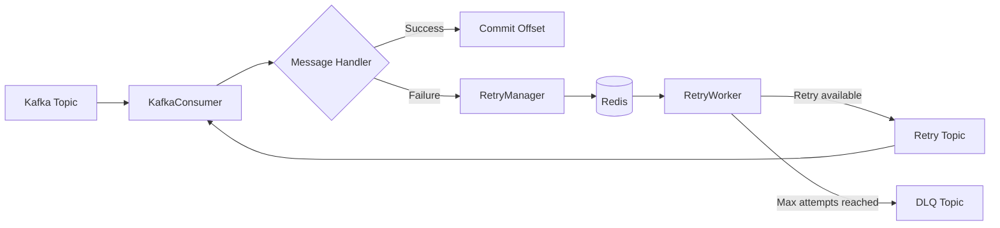

# @arcadia-man/kafka-retrier

Kafka consumer and retry orchestration library with Redis-backed retry scheduling.

It provides:

- Kafka producer and consumer management
- Retry with fixed or exponential backoff
- Redis-backed retry scheduling
- Maximum retry attempts
- Dead Letter Queue (DLQ)
- Multiple consumers using one shared Kafka connection

## Architecture



### Responsibility

| Component | Responsibility |
|---|---|
| `Kafka` | Shared Kafka connection |
| `KafkaProducer` | Publish Kafka messages |
| `KafkaConsumer` | Consume and process messages |
| `RetryManager` | Create retry jobs |
| `RetryWorker` | Process scheduled retries |
| `RetryStore` | Store retry state in Redis |

Your application owns the **business logic and consumer handlers**.

---

## Installation

```bash
npm install @arcadia-man/kafka-retrier
```

Requires:

- Node.js 18+
- Kafka
- Redis

---

## Configuration

```js
const config = {
  kafka: {
    clientId: "order-service",
    brokers: ["localhost:9092"],
  },

  redis: {
    url: "redis://localhost:6379",
  },
};
```

---

## Basic Usage

```js
const {
  Kafka,
  KafkaConsumer,
  KafkaProducer,
  RetryStore,
  RetryManager,
  RetryWorker,
} = require("@arcadia-man/kafka-retrier");
```

### 1. Create Kafka connection

Only create **one `Kafka` instance per application process**.

```js
const kafka = new Kafka(config.kafka);
```

### 2. Create producer

```js
const producer = kafka.createProducer();

await producer.connect();

await producer.send({
  topic: "order-created",
  messages: [
    {
      key: "order-123",
      value: JSON.stringify({
        orderId: "order-123",
      }),
    },
  ],
});
```

### 3. Create retry components

```js
const retryStore = new RetryStore(redis);

const retryManager = new RetryManager({
  retryStore,
  retryConfig: {
    maxAttempts: 3,
    strategy: "exponential",
    initialDelayMs: 1000,
    maxDelayMs: 30000,
  },
});

const retryWorker = new RetryWorker({
  retryStore,
  producer,
});
```

Start the worker:

```js
await retryWorker.start();
```

### 4. Create consumer

```js
const consumer = kafka.createConsumer({
  groupId: "order-service",
});

await consumer.connect();

await consumer.subscribe({
  topic: "order-created",
  fromBeginning: false,
});

await consumer.start(async (message) => {
  const order = JSON.parse(message.data);

  console.log("Processing order:", order.orderId);

  // Your business logic
});
```

---

# Retry on Failure

Pass `RetryManager` to the consumer.

```js
const consumer = kafka.createConsumer({
  groupId: "order-service",
  retryManager,
});
```

Now if the handler throws an error:

```js
await consumer.start(async (message) => {
  const order = JSON.parse(message.data);

  await processOrder(order);
});
```

The library automatically:

```text
Consumer
   ↓
Handler fails
   ↓
RetryManager
   ↓
Redis
   ↓
RetryWorker
   ↓
Retry Topic
   ↓
Consumer
```

---

# Retry Configuration

### Fixed retry

```js
{
  maxAttempts: 3,
  strategy: "fixed",
  delayMs: 5000
}
```

Retry after 5 seconds for every attempt.

### Exponential retry

```js
{
  maxAttempts: 5,
  strategy: "exponential",
  initialDelayMs: 1000,
  maxDelayMs: 30000
}
```

Example:

```text
Attempt 1 → 1s
Attempt 2 → 2s
Attempt 3 → 4s
Attempt 4 → 8s
Attempt 5 → 16s
```

The delay is capped by `maxDelayMs`.

---

# Dead Letter Queue

When the maximum retry attempts are reached, the message is sent to the DLQ.

```text
Original Topic
      ↓
   Consumer
      ↓
    Failure
      ↓
    Retry
      ↓
    Retry
      ↓
 Max Attempts
      ↓
     DLQ
```

Configure retry and DLQ topics in your consumer configuration.

---

# Message Object

The consumer handler receives a standardized message:

```js
await consumer.start(async (message) => {
  console.log(message.data);

  console.log(message.meta);
});
```

`message.data` contains the original message value.

`message.meta` contains Kafka and retry information such as:

```js
{
  topic,
  partition,
  offset,
  key,
  headers,
  retry
}
```

Retry metadata is available when the message is being processed through the retry flow.

---

# Complete Example

```js
const {
  Kafka,
  RetryStore,
  RetryManager,
  RetryWorker,
} = require("@arcadia-man/kafka-retrier");

const { createClient } = require("redis");

async function main() {
  const kafka = new Kafka({
    clientId: "order-service",
    brokers: ["localhost:9092"],
  });

  const redis = createClient({
    url: "redis://localhost:6379",
  });

  await redis.connect();

  const producer = kafka.createProducer();
  await producer.connect();

  const retryStore = new RetryStore(redis);

  const retryManager = new RetryManager({
    retryStore,
    retryConfig: {
      maxAttempts: 3,
      strategy: "exponential",
      initialDelayMs: 1000,
      maxDelayMs: 30000,
    },
  });

  const retryWorker = new RetryWorker({
    retryStore,
    producer,
  });

  await retryWorker.start();

  const consumer = kafka.createConsumer({
    groupId: "order-service",
    retryManager,
  });

  await consumer.connect();

  await consumer.subscribe({
    topic: "order-created",
    fromBeginning: false,
  });

  await consumer.start(async (message) => {
    const order = JSON.parse(message.data);

    console.log("Processing:", order.orderId);

    await processOrder(order);
  });
}

main().catch(console.error);
```

---

# Delivery Model

The library provides **at-least-once delivery**.

Your message handler should therefore be safe to execute more than once.

For example:

```js
await processOrder(order);
```

should ideally be **idempotent** when processing the same order multiple times.

---

# Multiple Consumers

You can create multiple consumers while sharing the same Kafka connection:

```js
const kafka = new Kafka({
  clientId: "order-service",
  brokers: ["localhost:9092"],
});

const orderConsumer = kafka.createConsumer({
  groupId: "order-service",
});

const paymentConsumer = kafka.createConsumer({
  groupId: "payment-service",
});
```

This avoids creating a separate Kafka connection for every consumer.

---

# Development

Clone the repository:

```bash
git clone https://github.com/arcadia-man/kafka-retrier.git
cd kafka-retrier
```

Install dependencies:

```bash
npm install
```

Run tests:

```bash
npm test
```

---

# License

MIT